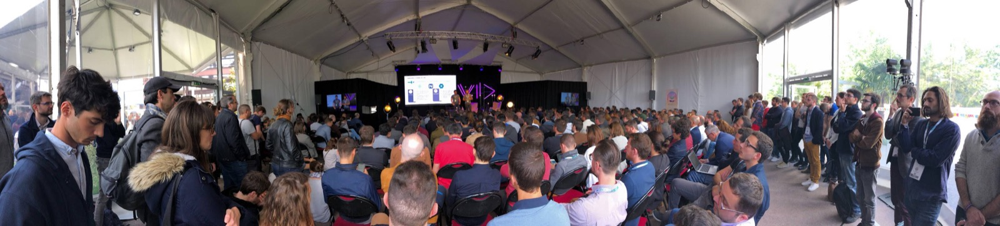
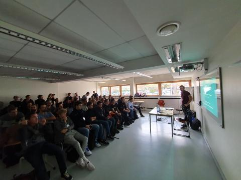

# 👋 Salut, moi c'est Simon Belbeoch (@LiquidITGuy)

Développeur full stack et **Manager Référent chez [OCTO Technology](https://www.octo.com/)**, où je suis co-lead de la tribu *Offline & Scalable Web*.
Je porte chez OCTO le sujet des **Progressive Web Apps** (Service Workers, Web Capabilities, web hors-ligne) et j'explore aujourd'hui la **modernisation de code legacy** et le **delivery à l'ère de l'IA**.

- 🎤 Speaker passionné en conférences tech (DevFest, JUG Summer Camp, Snowcamp, Agile Tour…) et **disponible pour venir parler à ton événement** → [voir mes talks](#-talks)
- 👀 Fan de projets open source auto-hébergés… et de 🍸 mixologie
- 📫 Je t'ai mis une étoile ? N'hésite pas à me contacter si je peux aider ton projet

## 🛠️ Ce que je fais

Je peux t'aider sur ton projet open source pour :
- la structuration du code, les programmes Node.js et les API REST ;
- le front en Next.js/React, Vue.js ou vanilla JS (architecture de composants, design system, tests…) ;
- les PWA, le web hors-ligne et le debug avec les Chrome DevTools ;
- la traduction française, la documentation et l'outillage (lint, stratégie de test, conventions de commit…).

## 🎤 Talks

> [!TIP]
> **J'adore partager sur scène !** Tu organises une conférence, un meetup, un BBL ou un atelier ? Je suis disponible pour venir présenter un de mes talks ou en construire un sur mesure (PWA, Chrome DevTools, modernisation de legacy avec l'IA, delivery à l'ère de l'IA…).
> 📫 Contacte-moi sur [LinkedIn](https://www.linkedin.com/in/simonbelbeoch/) ou retrouve mes sujets sur [Sessionize](https://sessionize.com/simon-belbeoch).

### 📅 Retrouve-moi bientôt sur scène

| Date | Événement | Lieu | Talk |
| --- | --- | --- | --- |
| 1ᵉʳ déc. 2026 · 15h30 | ☁️ **[Azur Tech Winter 2026](https://www.telecom-valley.fr/azurtechwinter/)** ([programme](https://www.telecom-valley.fr/wp-content/uploads/2026/10/Programme-Azur-Tech-Winter-2026.pdf)) | Sophia Antipolis · Campus SophiaTech | Chrome DevTools from Zero to Hero |
| 14-16 janv. 2027 | ❄️ **[Snowcamp 2027](https://snowcamp.io/)** | Grenoble · [Alpexpo](https://snowcamp.io/alpexpo) | Chrome DevTools from Zero to Hero *(format Schuss)* |
| 2 févr. 2027 | 🎓 **[Epitech Summit 2027](https://summit.epitech.eu/)** | Bordeaux | REX : codez moins, gérez plus, la nouvelle réalité des devs face à l'IA |
| 2 févr. 2027 | 🎓 **[Epitech Summit 2027](https://summit.epitech.eu/)** | Bordeaux | Jurassic Code : moderniser 100k lignes de Django/jQuery grâce à l'IA |

🤫 **Spoiler, en préparation :**
- **Les PWA à l'assaut des stores !** *(avec Théo Gautier)* : Google Play, Microsoft Store et App Store sans une ligne de code natif… en survivant à la règle 4.2 d'Apple et au jour où Apple a voulu retirer les PWA
- un talk qui relie la **technique et l'UX**, notamment à travers le **DDD** *(avec Cécile Freyd-Foucault)*

### 🗂️ Tous mes talks

| Talk | Événements |
| --- | --- |
| **Chrome DevTools from Zero to Hero** | [Azur Tech Winter 2026](https://www.telecom-valley.fr/azurtechwinter/) *(à venir)* · Snowcamp 2027 *(à venir)* · [JUG Summer Camp 2026](https://www.youtube.com/watch?v=Xr1gn_x5was) 📺 · Web Days 2026 · [DevFest Dijon 2024](https://www.youtube.com/watch?v=NXQ2N5qEIr4) 📺 · [DevQuest 2024](https://www.youtube.com/watch?v=EmhR9xnAEFI) 📺 |
| **Jurassic Code : moderniser 100k lignes de Django/jQuery grâce à l'IA** | Epitech Summit 2027 *(à venir)* · [Agile en Seine 2026](https://www.agileenseine.com/programme/jurassic-code-moderniser-100k-lignes-de-django-jquery-grace-a-lia/) · [Agile Tour Montpellier 2026](https://agiletourmontpellier.fr/le-programme-de-lagile-tour-montpellier-2026/) |
| **REX : codez moins, gérez plus, la nouvelle réalité des devs face à l'IA** | Epitech Summit 2027 *(à venir)* · [Agile Tour Montpellier 2026](https://agiletourmontpellier.fr/le-programme-de-lagile-tour-montpellier-2026/) |
| **PWA : la rolls des web apps mobile first** | [Riviera Dev 2021](https://2021.rivieradev.fr/application/fr%3Furl=%252Fsession%252F1022.html) · Everywhere Event 2020 |
| **Une PWA pour les gouverner toutes** | [Web2day 2019](https://www.youtube.com/watch?v=_vQ5L_tgL44) 📺 *(avec Clément Dubois)* |
| **Une Progressive Web App en 90 minutes** *(atelier)* | DevFest Strasbourg 2019 *(avec Clément Dubois)* |
| **Les bases des PWA** | Meetup Kotlin Paris 2019 |

📺 = replay disponible · 🎙️ Invité du podcast **On part en prod** (2026) pour parler de reprise de projets legacy

Anciennes interventions (2013-2017) : pitchs, concours et médias autour d'Intuitive Communication et de Frankise

- **2017** : pitch de Frankise au *Demo Day* de The Schoolab et à *If You Are Going To San Francisco*
- **2016** : pitch de Frankise sur scène au *pstarter* de PEPITE / The Schoolab · conférence de presse de lancement d'Intuitive Communication v1 ([vidéo de présentation](https://www.youtube.com/watch?v=xMmrbrHs3CY) 📺) · co-organisation et intervention au *Tech You Up n°1* sur les objets connectés (MIAGE Entrepreneurs)
- **2016 · médias** : reportage France 3 (19/20 Paris et [12/13](https://www.franceinfo.fr/replay-jt/france-3/12-13/innovation-une-application-pour-les-muets_1461319.html) 📺) · interview sur [Europe 1](https://www.youtube.com/watch?v=E5wkm2AQwg8) 📺 · passage sur Vivre FM
- **2015** : pitch étudiant-entrepreneur à *MIAGE My Startup*
- **2014** : lauréat de la [Student DemoCup](https://www.youtube.com/watch?v=swLdGZNWONo) 📺 (catégorie Experiment) à l'Open World Forum · lauréat de l'**Étudiant de l'année** · prix CréaOrange à la SMOT (MIAGE)
- **2013** : finaliste des [101 projets](https://www.youtube.com/watch?v=or7SKLdSZxI) 📺 · prix du jury et du public au Prix Étudiants de la Fondation Sopra Steria-Institut de France · 1ʳᵉ place au défi CNIL de la Nuit de l'Info
- 📰 **Presse** : Le Parisien ([1](https://www.leparisien.fr/seine-saint-denis-93/bagnolet-93170/bagnolet-il-a-cree-l-application-qui-fait-parler-12-05-2016-5789893.php), [2](https://www.leparisien.fr/seine-saint-denis-93/son-appli-donne-de-la-voix-a-ceux-qui-parlent-mal-13-05-2016-5790791.php)) · L'Étudiant ([1](https://www.letudiant.fr/metiers/metiers---portraits-de-pros/cet-etudiant-cree-une-appli-pour-donner-la-parole-a-ceux-qui-ne-l-ont-pas.html), [2](https://www.letudiant.fr/metiers/metiers---portraits-de-pros/la-france-des-solutions-distingue-24-jeunes-qui-ont-de-l-avenir.html)) · Programmez! ([1](https://www.programmez.com/actualites/intuitive-communication-place-le-handicap-au-coeur-du-libre-21654), [2](https://www.programmez.com/actualites/open-world-forum-2014-les-gagnants-de-la-student-democup-21629), [3](https://www.programmez.com/actualites/un-etudiant-du-master-miage-de-luniversite-paris-1-pantheon-sorbonne-laureat-du-concours-de-20623))

### 📸 Sur scène

<table>
  <tr>
    <td align="center" colspan="2">
      
       <b>Web2day 2019</b> · salle comble pour « Une web app pour les gouverner toutes avec les PWA »
    </td>
  </tr>
  <tr>
    <td align="center" width="50%">
      
       <b>Web2day 2019</b> · PWA avec Clément Dubois
    </td>
    <td align="center" width="50%">
      
       <b>DevFest Strasbourg 2019</b> · atelier PWA
    </td>
  </tr>
</table>

## ✍️ Écrits

- 📰 **Programmez! n°274** : dossier sur les Chrome DevTools
- 🃏 **[Refcard PWA d'OCTO](https://publication.octo.com/fr/telechargement-refcard-pwa)**, avec Aghiles Ben Kaoudjt et Florian Lévy
- 📝 Sur le [blog OCTO](https://blog.octo.com/author/simon.belbeoch) :
  - [C'est quoi une Progressive Web App (PWA) ?](https://blog.octo.com/cest-quoi-une-progressive-web-app-pwa)
  - [Chrome DevTools : de novice à expert](https://blog.octo.com/probleme-d'accessibilite-de-perf-ou-de-debug-comment-votre-navigateur-peut-vous-aider)
  - [Le web en temps réel : concepts et mises en œuvre](https://blog.octo.com/le-web-en-temps-reel)
  - La série **Web hors-ligne** :
    [l'alliance UX et éco-responsabilité](https://blog.octo.com/octo-web-hors-ligne--optimiser-l'experience-utilisateur-sans-connexion) ·
    [précacher avec des fallbacks](https://blog.octo.com/web-hors-ligne--precacher-votre-application-pour-un-usage-hors-ligne-degrade-avec-des-fallback) ·
    [stratégies de cache](https://blog.octo.com/web-hors-ligne--strategies-de-cache-du-plus-green-au-plus-simple-entre-offline-first-et-online-first) ·
    [Stale While Revalidate](https://blog.octo.com/web-hors-ligne--stale-while-revalidate-ou-le-meilleur-de-l'ux-pour-le-pire-de-l'ecoresponsabilite) ·
    [des métriques positives](https://blog.octo.com/web-hors-ligne--des-metriques-positives-pour-l'utilisateur-comme-pour-la-planete) ·
    [from scratch vs Workbox](https://blog.octo.com/web-hors-ligne--from-scratch-vs-workbox) ·
    [passons en mode test](https://blog.octo.com/web-hors-ligne--passons-en-mode-test)

## 🚀 Projets & open source

- 🧭 **[Am I doing this in prod ?](https://chromewebstore.google.com/detail/am-i-doing-this-in-prod/aoglejgecidnodkkogbgieidhmhjjnch)** ([code](https://github.com/floragc-octo/am-i-doing-this-in-prod)) : une extension Chrome et Firefox pour reconnaître ses environnements en un coup d'œil, co-développée avec Flora Guy-Coichard
- 🔧 **[chrome-devtoools](https://github.com/LiquidITGuy/chrome-devtoools)** : les démos et la cheat sheet (FR/EN) de mon talk sur les DevTools
- 🗣️ **[Intuitive Communication](https://github.com/LiquidITGuy/Intuitive-Communication-v2)** : une app open source pour aider les personnes ayant des difficultés d'élocution à communiquer

### 🤝 Contributions publiques

- **[CapRover](https://github.com/caprover)** : de nombreuses one-click apps, de la doc et du frontend
- **Docs & libs** : [MDN](https://github.com/mdn/content), [node-mssql](https://github.com/tediousjs/node-mssql), [nextcloud-vue](https://github.com/nextcloud-libraries/nextcloud-vue), [strapi-plugin-meilisearch](https://github.com/meilisearch/strapi-plugin-meilisearch)
- **Extensions navigateur** : [github-pull-request-highlighter](https://github.com/floragc-octo/github-pull-request-highlighter)
- **Communs numériques de l'État** : [1 jeune 1 solution](https://github.com/DGEFP-1j1S/1j1s-front) et [sirena](https://github.com/DNUM-SocialGouv/sirena)

## 🧑‍💻 Parcours

- **2018 → aujourd'hui · OCTO Technology** : Manager Référent, co-lead de tribu, tech lead et développeur full stack
  Certification Opquast
  

  
Missions principales

  - **2026** : API as a product (NestJS) pour un outil d'aide à la vente augmenté par l'IA, et expérimentation d'un delivery transformé par l'IA dans une squad de 3 pizza teams
  - **2025-2026** : Tech lead de la modernisation d'une application Django 1.x/jQuery, avec un framework de migration de legacy assisté par IA
  - **2023-2025** : Tech lead de Beezy, un projet interne OCTO
  - **2022-2023** : Tech lead d'équipe, puis Tech lead transverse, sur [1 jeune 1 solution](https://github.com/DNUM-SocialGouv/) (ministère des Affaires sociales et de la Santé)
  - **2021-2022** : Business France / Team France Export, Galderma, Wakam, Hermes traçabilité
  - **2020** : Tech lead chez Wakam (souscription d'assurance self-service B2B2C) et conseil PWA pour Softway Medical et Decathlon
  - **2018-2020** : Expert front puis Tech lead sur la marketplace agricole Aladin d'InVivo Digital Factory, dont Lead PWA
  

- **2015 → 2018 · Frankise SAS** : CEO-CTO
- **2013 → 2015 · SFR Business Team** : ingénieur études et développement, et assistant chef de projet MOA
- **2012 → 2013 · Orange Business Services** : expert technique sur les serveurs d'applications web
- 🎓 **Université Paris 1 Panthéon-Sorbonne** : Master MIAGE (2e de promotion) · DUT Informatique · DU étudiant-entrepreneur
